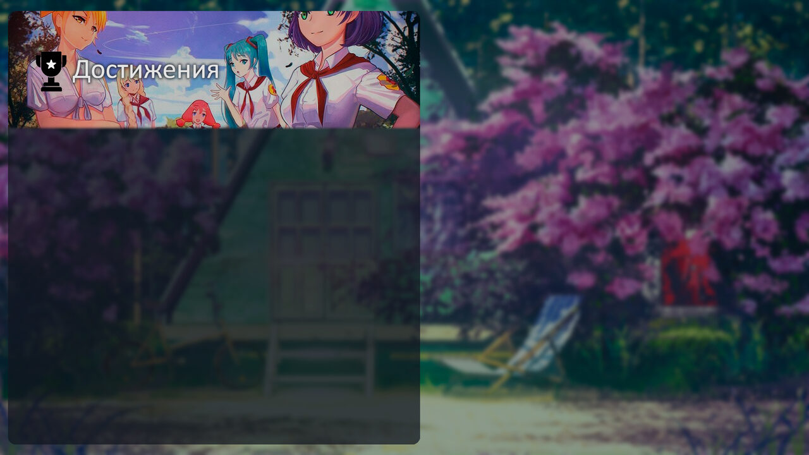
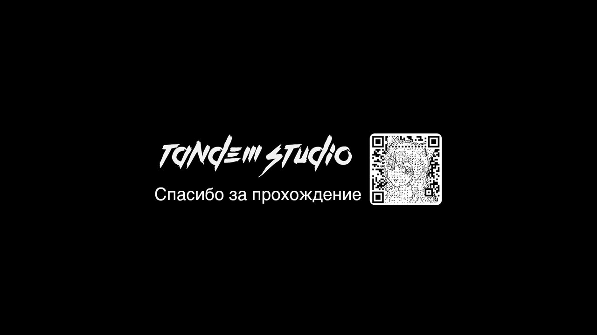

# Не просто сон. Director's Cut

Авторская переработка мода **«Это не просто сон, верно?»** (оригинальный мод — Илья Вольнов).

Мод для игры **«Бесконечное лето»** (Everlasting Summer, Steam AppID 331470).

- Версия: **3.0 (Director's Cut)**; основана на оригинальной ветке 2.4.226Y
- Автор: **Илья Вольнов**
- Оригинал: https://github.com/ilyamaximusaws/ne-prosto-son-directors-cut
- Лицензия: **CC BY-NC-SA 4.0** (см. раздел «Лицензия»)
- Steam Workshop: элемент `3003746576` — отдельная версия, выпущенная бывшими соавторами; этот репозиторий содержит авторскую Director's Cut. Подробнее — в разделе [DC и Steam Workshop](#dc-и-steam-workshop).
- Корневая папка мода: `notdream/`

## Содержание

- [О моде](#о-моде)
- [Возможности](#возможности)
- [Скриншоты](#скриншоты)
- [Установка](#установка)
- [Структура](#структура)
- [Файлы в корне](#файлы-в-корне)
- [Папки](#папки)
- [Типы файлов](#типы-файлов)
- [Версия и история](#версия-и-история)
- [Авторы и благодарности](#авторы-и-благодарности)
- [DC и Steam Workshop](#dc-и-steam-workshop)
- [Технические заметки](#технические-заметки)
- [Лицензия](#лицензия)

## О моде

«Не просто сон. Director's Cut» — сюжетная модификация для «Бесконечного лета». Это авторская редакция мода «Это не просто сон, верно?»; последняя версия оригинальной ветки — 2.4.226Y (технодемо).

По состоянию на 2.4.226Y в моде есть пролог, первая глава (шесть дней и эпилог) и вторая глава (3+ эпизода), четыре концовки, персонаж Даша, QTE и мини-игры, собственный интерфейс и система достижений.

Director's Cut 3.0 сохраняет содержимое 2.4.226Y: игровые скрипты не переписывались, изменения касаются названия, лицензии, документации и очистки репозитория от кэша `.rpyc`.

## Возможности

- Пролог, первая глава (6 дней + эпилог), вторая глава (3+ эпизода) — по состоянию на 2.4.226Y.
- Четыре концовки.
- Экран выбора глав и экран версии мода и игры.
- Достижения с отдельным экраном и статистикой.
- Отдельные слоты сохранений, не пересекающиеся с оригинальным БЛ и другими модами.
- Озвучка с возможностью отключения; авторская озвучка одного момента в 5-м дне.
- Распознавание музыки (аддон Shazam).
- QTE и мини-игры.
- Секретные развилки и секреты, включая дополнительный секрет в 5-м дне.
- Режим разработчика и экран «О моде».
- Пропуск текста, автосохранения каждые 300 действий, музыка в меню по времени суток.
- Собственные диалоговые окна, GUI и курсоры, зависящие от времени суток.

## Скриншоты

Экран выбора глав:


Экран достижений:



Экран завершения:



Скриншоты сняты с интерфейса оригинальной ветки 2.4.226Y; в DC 3.0 интерфейс не менялся.

## Установка

Содержимое репозитория — папка мода `notdream` для загрузчика модов Everlasting Summer. При ручной установке папка `notdream` кладётся в каталог модов игры. Не путать с версией из Steam Workshop: это отдельная ветка мода.

В репозитории нет файлов `.rpyc`: это скомпилированный кэш Ren'Py, который «Бесконечное лето» создаёт само из `.rpy` при запуске. В репозиторий включены только исходники `.rpy`.

## Структура

```text
notdream/
├── _supersecret.rar         # запароленный архив: сценарий и доп. материалы (71 076 190 байт)
├── Changelog.txt            # исторический changelog оригинального мода до версии 2.4.226Y
├── nd_main.rpy              # основной скрипт мода (139 870 байт)
├── nd_start.rpy             # инициализация и точка старта мода (7 137 байт)
├── .vscode/                 # настройки редактора VS Code (1 файл)
├── achievements/            # достижения (36 файлов, 5.5 МБ)
├── addons/                  # дополнительный контент (59 файлов, 84 МБ)
├── audio/                   # музыка, звуки, эмбиент, озвучка (459 файлов, 1.1 ГБ)
├── days/                    # сценарии дней (8 файлов, 2.4 МБ)
├── dev_tools/               # инструменты разработчика (14 файлов, 4.4 МБ)
├── fonts/                   # шрифты (12 файлов, 1.2 МБ)
├── images/                  # фоны, спрайты, CG, эффекты (615 файлов, 400 МБ)
├── minigames/               # мини-игры (6 файлов)
└── UserInterface/           # интерфейс и меню (311 файлов, 62 МБ)
```

Всего в репозитории: **1531 файл** (1525 файлов мода, README, LICENSE, NOTICE и 3 скриншота), около **1.7 ГБ**.

Служебные файлы репозитория (`README.md`, `LICENSE`, `NOTICE`, `docs/screenshots/`) в дерево мода не входят.

## Файлы в корне

| Файл | Назначение |
| --- | --- |
| `nd_main.rpy` | Основной скрипт мода: общая логика, метки и связка сценариев дней. Исходник Ren'Py. |
| `nd_start.rpy` | Инициализация мода: импорты, определение времени суток по системным часам, стартовая метка `notdream`. |
| `Changelog.txt` | Исторический список изменений оригинального мода до версии 2.4.226Y. Версии Director's Cut описаны ниже. |
| `_supersecret.rar` | Запароленный архив с файлами сценария (docx) и дополнительными материалами. Пароль в репозитории отсутствует, содержимое архива не распаковано. |
| `README.md` | Это описание структуры, версий и лицензии. |
| `LICENSE` | Полный текст лицензии CC BY-NC-SA 4.0. |
| `NOTICE` | Обязательная формулировка атрибуции и границы авторства. |

## Папки

### `.vscode/`
Служебные настройки VS Code для работы с модом: `files.exclude` скрывает в редакторе скомпилированные `.rpyc`/`.rpa`, кэш и т.п. На игру не влияет.

### `achievements/`
Достижения мода: иконки PNG/JPG и звуки OGG, скрипты выдачи и отображения. В подпапке `onscreen/` — экранные достижения, экран статистики, движок музыки и метки.

### `addons/`
Дополнительный контент. В `official_c2_content/` — официальный контент C2: 7 скриптов Ren'Py (пролог, эпилог и пять частей сценария), а также изображения и звуки.

### `audio/`
Все звуковые ресурсы, 459 файлов:
- `music/` — музыка (223 файла, MP3);
- `sounds/` — звуковые эффекты (137 файлов);
- `ambience/` — фоновые шумы и эмбиент (52 файла);
- `voice/` — озвучка (47 файлов).

### `days/`
Сценарии игровых дней и сна: `nd_day_1.rpy` … `nd_day_6_us.rpy`, `nd_dream_1.rpy`. Файл-заглушка «DON'T OPEN ALL FILES HERE» (в имени используется обратная кавычка вместо апострофа) пустой и служит предупреждением.

### `dev_tools/`
Инструменты разработчика: меню разработчика, тесты, отладочные сценарии. В `about_screen/` — экран «О моде».

### `fonts/`
Шрифты мода: 11 TTF и 1 OTF (основные, рукописные, заголовочные).

### `images/`
Графика, 615 файлов:
- `bg/` — фоны (199 файлов);
- `sprites/` — спрайты персонажей, включая `us/` (210 файлов);
- `anim/` — анимации (62 файла);
- `cg/` — CG-иллюстрации (архив `.rpa`);
- `ends/` — экраны концовок (15 файлов);
- `extra/` — дополнительные изображения (27 файлов);
- `gorod_d5/` — графика города для дня 5 (46 файлов);
- `notdream_rain_bg/` — фоны дождя (39 файлов);
- `particles/` — частицы (10 файлов);
- `disclamer/` — дисклеймер (3 файла);
- `effects/` — эффекты (5 файлов);
- `sprites_nd.rpy` и `us/nd_us_sprites.rpy` — скрипты определения спрайтов;
- два архива `.rpa` с ресурсами Ren'Py.

### `minigames/`
Мини-игры: `click_to_win/` (5 файлов) и `QTE/` (3 файла), плюс скрипты `minigame_nd_2.rpy` и `QTE.rpy`.

### `UserInterface/`
Интерфейс и меню, 311 файлов:
- `gui/` — общие элементы интерфейса (160 файлов), скрипты `nd_gui_screens.rpy`, `nd_script.rpy`;
- `Main_menu/` — главное меню (44 файла);
- `Parts_screen_nd/` — экран выбора частей (23 файла);
- `Loadscreens/` — экраны загрузки (20 файлов);
- `f_settings/` — настройки (16 файлов);
- `cur/` — курсоры (14 файлов);
- `entercode_prefs/` — экран ввода кода (11 файлов);
- `voicemenu/` — меню озвучки (8 файлов).

## Типы файлов

- `.rpy` — исходные скрипты Ren'Py;
- `.rpa` — архивы ресурсов Ren'Py;
- `.png`, `.jpg`, `.ogv` — графика и видео;
- `.mp3`, `.ogg` — звук;
- `.ttf`, `.otf` — шрифты;
- `.rar` — запароленный архив дополнительных материалов (`_supersecret.rar`).

`.rpyc` в репозитории не хранятся: игра компилирует `.rpy` в `.rpyc` сама при запуске.

## Версия и история

### Нумерация оригинальной ветки

Версии оригинального мода имели вид `a.b.c(AFB)`:
- `a` — номер главы;
- `b` — число концовок;
- `c` — общее число строк в файле разрабатываемого дня, делённое на номер дня;
- `A` — стабильная версия, проверена бета-тестерами;
- `F` — возможны мелкие баги с изображениями и текстом;
- `B` — нестабильная;
- `Y` — технодемо.

По этой схеме **2.4.226Y** — вторая глава, четыре концовки, технодемо.

### Хронология

- **01.09.2019** — релиз в Steam.
- **07.07.2020** — REBORN: собственное GUI, 4-й день, отдельные слоты сохранений, новая музыка, фоны и CG.
- **2020–2021** — обновления интерфейса, 6-й день и эпилог первой главы, мини-игры, озвучка, распознавание музыки.
- **24.02.2022** — вторая глава (3+ эпизода), новый вступительный экран, переработанный UI/UX.
- **2.4.226Y** — последняя версия оригинальной ветки (технодемо).
- **2026** — Director's Cut 3.0.

### Director's Cut

Собственная нумерация начинается с 3.0, чтобы версии не путались с оригинальной веткой.

- **3.0** — новое название, лицензия CC BY-NC-SA 4.0 и правила атрибуции, документация, удаление кэша `.rpyc` из репозитория. Содержимое мода основано на 2.4.226Y.

Исторический changelog: [Changelog.txt](Changelog.txt). Он описывает только оригинальную ветку до 2.4.226Y; версии DC в нём нет. Структура мода в changelog устарела — там перечислены только 6 папок, актуальная структура выше.

## Авторы и благодарности

### Director's Cut

- Автор: **Илья Вольнов**.

### Оригинальный мод «Это не просто сон, верно?»

По данным `Changelog.txt`:
- кодер и сценарист — [vexusmax](https://steamcommunity.com/id/vexusmax);
- композитор — [Денис Баклин](https://steamcommunity.com/id/baklindenisOchka/);
- бета-тестер — [профиль Steam](https://steamcommunity.com/profiles/76561198307188138/);
- отдельная благодарность — Soviet Tyan за поддержку и помощь в выпуске обновления 24.02.2022.

Авторство в репозитории разграничено: Илья Вольнов — авторские материалы и правки Director's Cut; остальные участники указаны согласно credits оригинального мода. Сторонние ассеты принадлежат их правообладателям (см. [NOTICE](NOTICE)).

## DC и Steam Workshop

В Steam Workshop мод опубликован как элемент `3003746576`. Это отдельная версия, выпущенная бывшими соавторами; она не идентична Director's Cut.

- В этом репозитории — авторская версия Director's Cut, нумерация с 3.0.
- В Workshop — версия прежней команды со своей нумерацией оригинальной ветки.
- У версий разный состав файлов и история изменений; не смешивайте их в одной папке модов.
- Перед переключением между версиями сделайте резервную копию сохранений.

Исходники и структура Director's Cut — только в этом репозитории.

## Технические заметки

Репозиторий весит около 1.7 ГБ — клонирование будет медленным. Если в дальнейшем планируются частые обновления больших аудио- и графических файлов, имеет смысл использовать Git LFS или выносить готовые сборки в GitHub Releases. Сейчас LFS и Releases не используются.

В оригинальной ветке были отдельные исправления для Linux (07.11.2020) и оптимизация времени запуска; актуальные цифры зависят от машины.

## Лицензия

Оригинальные материалы мода распространяются под **Creative Commons Attribution-NonCommercial-ShareAlike 4.0 International (CC BY-NC-SA 4.0)**: https://creativecommons.org/licenses/by-nc-sa/4.0/

- **BY (Attribution)** — при форке или распространении обязательна явная атрибуция: название «Не просто сон. Director's Cut» (авторская переработка мода «Это не просто сон, верно?»), имя автора «Илья Вольнов» и ссылка на оригинал https://github.com/ilyamaximusaws/ne-prosto-son-directors-cut. Атрибуция должна быть легко находимой — в README форка на первом экране или в разделе «Авторы»/«Credits».
- **NC (NonCommercial)** — только некоммерческое использование; мод распространяется бесплатно.
- **SA (ShareAlike)** — производные работы (форки) распространяются под той же лицензией CC BY-NC-SA 4.0.

Лицензия покрывает только оригинальные материалы автора. Сторонние ресурсы (музыка, шрифты, изображения и иные ассеты) принадлежат их правообладателям и не покрываются этой лицензией. `README.md`, `NOTICE`, редактура `Changelog.txt` и уменьшенные копии скриншотов в `docs/screenshots/` подготовлены Hermes (AI-ассистент) по запросу автора.

Полный текст лицензии: [LICENSE](LICENSE). Обязательная формулировка атрибуции: [NOTICE](NOTICE).